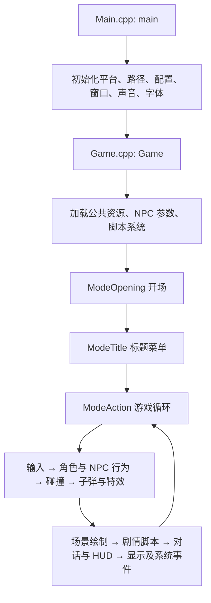

# CSE2 代码结构导读

基于当前 `portable` 分支及本地新增的 macOS 简体中文适配整理，日期：2026-09-24。

## 1. 整体结构

项目使用 C++ 和 CMake。游戏逻辑主要由结构体、全局状态、普通函数和函数指针表组成；不是以类继承或 ECS 为核心的现代引擎。跨平台移植保留了一些原版函数名，例如 `StartDirectDraw`、`InitDirectSound`，这些名称不代表 Mac 上实际使用 DirectX。

```text
CSE2/
├── CMakeLists.txt                编译入口、语言和音视频后端选择
├── src/                         游戏逻辑及引擎源码
│   ├── Main.cpp                 程序入口、平台初始化、系统事件
│   ├── Game.cpp                 开场、标题、游玩三种模式及每帧调度
│   ├── Backends/                平台、渲染、音频、手柄实现
│   ├── Resource/                构建生成的嵌入资源代码
│   └── StageChinese.inc         脚本生成的中文地图表
├── assets/resources/            编译进程序的音乐、图片等资源
├── game_english/data/           英文版运行资源
├── game_japanese/data/          日文版运行资源
├── game_chinese/                本地准备的中文运行目录（忽略提交）
│   ├── data/                   汉化资源与运行所需公共资源
│   ├── CSE2                    编译产物
│   └── 洞窟物语中文版.app       本机 Mac 应用入口
├── scripts/                     本地新增的中文资源准备、构建、打包脚本
├── 启动中文版.command            双击运行本机中文程序
├── DoConfig/                    可选的游戏配置工具
├── bin2h/                       将二进制资源转换成 C 头文件的工具
├── cmake/                       CMake 辅助模块
├── external/                    SDL2、FreeType、GLFW、glad 等依赖源码
├── build-chinese/               中文版 CMake 中间产物（忽略提交）
├── .local/                      下载缓存、解压文件、构建日志（忽略提交）
└── docs/                        项目导读
```

## 2. 从启动到每帧执行



- `Main.cpp::main()` 初始化运行环境，再进入 `Game()`；结束后释放字体、音频和图形资源。
- `Game.cpp::Game()` 通过 `mode` 和各模式的返回值切换开场、菜单及游戏状态。
- `Game.cpp::ModeAction()` 是阅读玩法的主要入口。实际顺序值得保留：先处理角色和 NPC，再处理碰撞、射击与子弹，随后绘制，后段执行 `TextScriptProc()` 并显示对话。
- `KeyControl.cpp::GetTrg()` 计算本帧新按下的按键；`Main.cpp::SystemTask()` 处理系统事件；`Input.cpp` 主要封装手柄接口。

## 3. 按功能找源码

| 功能 | 主要文件 | 职责 |
|---|---|---|
| 主角动作 | `src/MyChar.cpp/.h` | 移动、跳跃、动作状态与动画；核心状态 `gMC` |
| 主角属性 | `src/MycParam.cpp` | 生命、伤害、经验、武器能量、氧气及部分 HUD |
| 主角碰撞 | `src/MycHit.cpp` | 主角与地图、NPC、Boss 的碰撞 |
| 武器与背包 | `src/ArmsItem.cpp` | 武器及道具管理、背包界面 |
| 发射武器 | `src/Shoot.cpp` | 根据当前武器、等级和输入生成子弹 |
| 子弹更新 | `src/Bullet.cpp`、`src/BulHit.cpp` | 子弹行为、生命周期及地图碰撞 |
| NPC 管理 | `src/NpChar.cpp/.h` | NPC 的载入、生成、删除、更新、绘制；核心数组 `gNPC` |
| NPC 行为 | `src/NpcAct000.cpp` … `NpcAct340.cpp` | 按编号分组的具体 NPC/敌人行为函数 |
| NPC 参数及分派 | `src/NpcTbl.cpp`、`data/npc.tbl` | 行为函数表、NPC 参数载入；用类型编号定位 `ActNpcXXX` |
| NPC 碰撞 | `src/NpcHit.cpp` | NPC 与地图、子弹之间的碰撞 |
| Boss | `src/Boss.cpp`、`src/Boss*.cpp`、`src/BossLife.cpp` | Boss 调度、各 Boss 行为和生命条 |
| 关卡切换 | `src/Stage.cpp/.h` | 关卡表 `gTMT`、`TransferStage()`、音乐切换 |
| 地图 | `src/Map.cpp`、`src/Attributes.h` | 瓦片与碰撞属性、地图绘制及修改 |
| 背景与镜头 | `src/Back.cpp`、`src/Frame.cpp` | 背景滚动、镜头跟随和震动；这里的 Frame 指镜头 |
| 地图界面 | `src/MapName.cpp`、`src/MiniMap.cpp`、`src/SelStage.cpp` | 地图名、小地图和传送地点选择 |
| 剧情解释器 | `src/TextScr.cpp/.h` | TSC 载入、解码、命令执行、逐字显示；核心状态 `gTS` |
| 绘图与字体 | `src/Draw.cpp`、`src/Bitmap.cpp`、`src/Font.cpp` | 图片表面、位图解码、字形缓存与文字绘制 |
| 音乐与音效 | `src/Sound.cpp`、`src/Organya.cpp`、`src/PixTone.cpp` | 声音管理、Organya 音乐和 PixTone 音效生成 |
| 特效 | `src/Caret.cpp`、`src/Fade.cpp`、`src/Flash.cpp`、`src/ValueView.cpp` | 粒子、淡入淡出、闪光和数字显示 |
| 结局 | `src/Ending.cpp` | 片尾脚本、插图与滚动演职员信息 |
| 持久化 | `src/Profile.cpp`、`src/Flags.cpp`、`src/Config.cpp` | 存档、事件标志、配置读取和默认值 |
| 公共资源 | `src/GenericLoad.cpp`、`src/Resource.cpp`、`src/File.cpp` | 公共素材、嵌入资源、文件读取 |

`NpcActXXX` 中也有道具、机关、交互对象等，不能把所有 NPC 都当成敌人。定位某个角色时，先找到类型编号，再查 `NpcTbl.cpp` 中对应的行为函数。

## 4. 平台后端

```text
游戏逻辑（Game、Draw、Sound、Input）
                 ↓
Backends/ 下的 Rendering.h、Audio.h、Controller.h、Misc.h 接口
                 ↓
CMake 选择具体的 SDL、OpenGL、GLFW 或主机平台实现
```

当前中文构建使用：

- 平台：`Backends/Platform/SDL2.cpp`。
- 渲染：`Backends/Rendering/SDLTexture.cpp`。
- 音频：`Backends/Audio/SoftwareMixer.cpp` 及其 SDL2 输出实现。
- 手柄：`Backends/Controller/SDL.cpp`。
- 字体：FreeType。`CHINESE=ON` 在 CMake 配置过程中启用它，即使缓存中的 `FREETYPE_FONTS` 原始值显示为 OFF。

## 5. 游戏资源与关卡加载

`Stage.cpp::TransferStage()` 根据 `gTMT` 的记录加载以下文件：

| 文件类型 | 作用 |
|---|---|
| `data/Stage/*.pxm` | 地图瓦片布局 |
| `data/Stage/*.pxa` | 瓦片属性、碰撞类型 |
| `data/Stage/*.pxe` | 关卡 NPC 与事件布置 |
| `data/Stage/*.tsc` | 当前关卡的对话与剧情命令 |
| `data/Stage/Prt*.pbm` | 关卡瓦片图像 |
| `data/Npc/Npc*.pbm` | NPC 图集 |
| `data/Head.tsc` | 公共脚本 |
| `data/ArmsItem.tsc` | 武器与道具相关文本 |
| `data/Credit.tsc` | 演职员脚本 |
| `data/npc.tbl` | NPC 基础参数 |

这里的 `.pbm` 是游戏使用的图片扩展名，不应仅凭扩展名当作标准 Portable Bitmap 格式。`.tsc` 文件在磁盘上经过游戏的编码处理，不能直接当普通文本编辑；要先按照 `TextScr.cpp::EncryptionBinaryData2()` 的逻辑解码，再编辑并重新编码。当前汉化正文使用 GBK，不是 UTF-8。

## 6. 本地新增的中文适配

| 文件 | 新增内容 |
|---|---|
| `CMakeLists.txt` | `CHINESE` 构建选项、中文输出目录、Iconv 和 FreeType 支持 |
| `src/ChineseEncoding.h` | GBK → Unicode 解码，并处理无效或截断字符 |
| `src/Font.cpp` | 中文解码分支、中文字形尺寸及固定宽度排版 |
| `src/Draw.cpp` | 加载 macOS 的 `STHeiti Medium.ttc`；可用 `CSE2_CHINESE_FONT` 指定其他字体 |
| `src/Stage.cpp` | 中文构建时使用生成的地图名称表 |
| `src/StageChinese.inc` | 从原汉化包提取的 95 个地图名称，由准备脚本生成 |
| `src/Main.cpp` | 中文窗口标题 |
| `src/Config.cpp` | 中文版默认使用 640×480 窗口 |
| `scripts/prepare_chinese.py` | 下载并校验汉化包、合并资源、保留译者说明、提取地图名称 |
| `scripts/build_chinese_macos.sh` | 准备资源 → CMake 配置 → 编译 → 生成本机启动入口 |
| `scripts/package_chinese_macos.py` | 创建 `.app` 和 `启动中文版.command` |

构建命令（在仓库根目录执行）：

```bash
bash scripts/build_chinese_macos.sh
```

构建需要 Homebrew、CMake、Python 3、SDL2、FreeType、pkg-config 和 Xcode 命令行工具。已有二进制时，可双击根目录的 `启动中文版.command`。

当前 `.app` 是本机入口：仍依赖本机 Homebrew 动态库，且通过相对符号链接使用 `game_chinese/data`。不能把 `.app` 单独拷走就当作独立发布包。应用入口和命令行入口可能把存档写入不同的程序基路径，使用时宜固定一种入口。

截至本次梳理，中文构建已经通过、应用窗口及开场画面已打开；上一轮交互验证被中断，中文对话排版、完整流程及存读档还没有完成实际验证。

## 7. 常见修改从哪里开始

| 想修改什么 | 优先阅读 |
|---|---|
| 移动速度、跳跃高度和手感 | `MyChar.cpp` → `MycHit.cpp` |
| 武器威力、射速、弹道 | `Shoot.cpp` → `Bullet.cpp` → `NpcHit.cpp` |
| 怪物 AI | `NpcTbl.cpp` → 对应 `NpcActXXX.cpp` |
| Boss 战 | `Boss.cpp` → 对应 `Boss*.cpp` |
| 剧情、对话、门的跳转 | 关卡 `.tsc` → `TextScr.cpp` → `Stage.cpp` |
| 地图和碰撞 | `.pxm`、`.pxa`、`.pxe` → `Map.cpp` |
| 中文乱码、字体或文字间距 | `ChineseEncoding.h` → `Font.cpp` → `Draw.cpp` → `TextScr.cpp` |
| 窗口和画面输出 | `Main.cpp` → `Draw.cpp` → `Backends/Rendering/SDLTexture.cpp` |
| 存档内容 | `Profile.cpp` → `Flags.cpp` |

推荐阅读顺序：`Main.cpp` → `Game.cpp::ModeAction()` → `MyChar.cpp` → `Stage.cpp::TransferStage()` → `TextScr.cpp` → 所需的 NPC 或武器模块。

注意区分逻辑坐标和屏幕像素：许多玩法位置使用 `0x200` 为单位的定点数，一个地图格为 16 像素；关卡切换代码中的 `x * 0x10 * 0x200` 就是从格子坐标转换为内部坐标。直接按像素修改这些值容易导致移动或碰撞异常。

修改时应编辑源码和生成脚本；`src/Resource/`、`src/StageChinese.inc`、构建目录和汉化运行资源会被重新生成。特别是 `prepare_chinese.py` 会重新覆盖资源，直接改 `game_chinese/data` 的内容需要另行保存或纳入准备流程。
