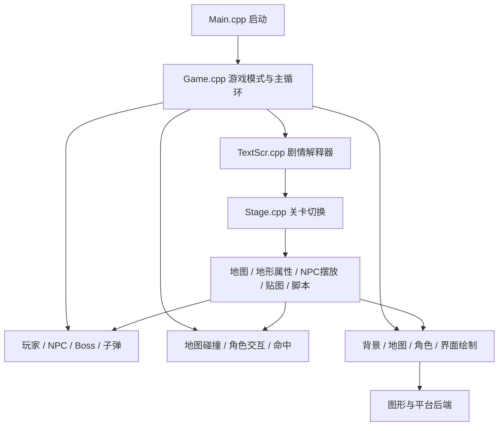

# 洞窟物语：代码层级与框架解读

编写日期：2026-10-14。依据本仓库 `CSE2/` 的实际源码，包含当前移植版与中文适配。本文所说“层级”是为了帮助理解而归纳的职责层级，并非源码存在一套严格分层的类体系。

## 1. 先理解整个游戏怎样组成

洞窟物语可以理解成四部分共同工作：

1. **程序规则**：角色怎样走、敌人怎样攻击、碰撞怎样处理，由 C++ 函数决定。
2. **关卡数据**：地图格子、敌人位置、背景和贴图选择，决定这一关长什么样。
3. **剧情脚本**：对话、开门、转场、改变人物状态，负责把关卡串成故事。
4. **平台后端**：创建窗口、读取按键、显示画面、播放声音，让游戏在具体设备上运行。

关卡很多，并不意味着每关各有一个完整的游戏程序。通常是同一套运行规则，加载不同数据和事件。



## 2. 实际文件夹树

下面保留与阅读有关的目录和代表文件，不逐项展开所有文件。

```text
CSE2/
├── CMakeLists.txt              构建配置、功能选项、后端选择
├── README.md                  项目介绍与构建说明
├── PHILOSOPHY.md               移植与代码维护思路
├── LICENCE.txt                代码授权说明
├── cmake/                     CMake 辅助文件
├── external/                  外部依赖相关文件
├── assets/                    构建使用的资源
├── bin2h/                     二进制资源转头文件工具
├── scripts/                   本地辅助脚本
├── docs/                      项目附带文档
├── src/                       游戏与移植层源码
│   ├── Main.cpp               程序入口
│   ├── Game.cpp               开场、标题、游戏过程
│   ├── Stage.cpp              关卡表与关卡装载
│   ├── StageChinese.inc       当前中文适配的关卡表内容
│   ├── Map.cpp                地图格子与地形属性
│   ├── MyChar.cpp             玩家运动和动画
│   ├── MycHit.cpp             玩家碰撞
│   ├── MycParam.cpp           玩家参数相关处理
│   ├── NpChar.h / NpChar.cpp   NPC 数据结构、创建、更新、绘制
│   ├── NpcTbl.cpp             NPC 属性表加载、行为函数表
│   ├── NpcAct.h               NPC 行为函数声明
│   ├── NpcAct000.cpp          编号 000–019 的 NPC 行为
│   ├── NpcAct020.cpp          编号 020–039 的 NPC 行为
│   ├── ...                   通常每组 20 个编号分文件
│   ├── NpcAct340.cpp          从 340 开始的最后一组
│   ├── NpcHit.cpp             NPC 与地图等碰撞处理
│   ├── Boss.cpp               Boss 管理与行为分派
│   ├── BossFrog.cpp 等         各 Boss 的具体行为
│   ├── Shoot.cpp              武器发射逻辑
│   ├── Bullet.cpp             子弹数据、运动与绘制
│   ├── BulHit.cpp             子弹相关碰撞与命中
│   ├── ArmsItem.cpp           武器和物品管理
│   ├── TextScr.cpp            TSC 剧情脚本解释器
│   ├── Flags.cpp              持久事件标记
│   ├── Profile.cpp            存档读写与新游戏初始化
│   ├── Frame.cpp              镜头位置与跟随
│   ├── Back.cpp               背景运动与绘制
│   ├── Draw.cpp               绘图接口
│   ├── Caret.cpp              烟尘等短时视觉对象
│   ├── Fade.cpp / Flash.cpp   淡入淡出与闪光
│   ├── KeyControl.cpp         输入状态与按键触发
│   ├── Sound.cpp / Organya.cpp 音效与音乐
│   └── Backends/              图形、窗口、音频、输入等平台实现
├── game_chinese/              当前本地中文运行目录
│   └── data/
│       ├── Stage/             地图、摆放、脚本、地形贴图与属性
│       ├── Npc/               NPC 图集
│       ├── Font/              中文字体资源
│       └── ...                通用图像、npc.tbl、Head.tsc 等
├── game_english/              英文运行目录
├── game_japanese/             日文运行目录
└── build-chinese/             本地中文构建输出
```

`.h` 一般声明结构、常量和函数接口，`.cpp` 写具体实现。比如 `NpChar.h` 说明 NPC 有哪些数据，`NpChar.cpp` 负责管理这些数据，`NpcActXXX.cpp` 才处理每种 NPC 怎么行动。

## 3. 按职责划分的五层

| 阅读层级 | 代表模块 | 要回答的问题 |
| --- | --- | --- |
| 平台基础 | Main、Backends、Draw、Sound、KeyControl | 在电脑上怎样启动、输入、显示和播放声音？ |
| 游戏调度 | Game | 现在在标题还是游戏中？每帧先执行什么？ |
| 世界与内容 | Stage、Map、TextScr、Flags、Profile | 当前在哪一关？有哪些内容？剧情和进度是什么？ |
| 实体行为 | MyChar、NpChar、NpcAct、Boss、Shoot、Bullet | 玩家、怪物、武器每帧做什么？ |
| 交互与表现 | MycHit、NpcHit、BulHit、Frame、Caret、Fade | 谁撞到谁？镜头和画面怎样反馈？ |

这些层互相调用，尤其脚本可以改变 NPC、地图和关卡。它没有现代引擎那种严格模块隔离，因此不要把表格理解成只能单向访问的依赖规则。

## 4. 从启动到每一帧

入口在 [Main.cpp](../CSE2/src/Main.cpp)，其中 `main()` 完成启动相关工作后调用 `Game()`。

[Game.cpp](../CSE2/src/Game.cpp) 中的重要函数：

| 函数 | 职责 |
| --- | --- |
| Game | 初始化相关系统，并在不同模式之间调度 |
| ModeOpening | 开场演出 |
| ModeTitle | 标题界面 |
| ModeAction | 正常游玩时的主循环 |

理解框架最有效的入口是 `ModeAction`。正常游戏更新分支的主要调用顺序如下，省略了部分辅助效果：

```text
读取按键 GetTrg
  ↓
ActMyChar                    玩家行为
ActNpChar / ActBossChar       NPC 与 Boss 行为
  ↓
ResetMyCharFlag               清玩家本轮碰撞标记
HitMyCharMap                 玩家对地图
HitMyCharNpChar / Boss        玩家对 NPC / Boss
HitNpCharMap / HitBossMap     NPC / Boss 对地图
HitBulletMap                 子弹对地图
HitNpCharBullet / BossBullet  子弹对 NPC / Boss
  ↓
ShootBullet                  按输入发射
ActBullet / ActCaret          更新子弹与特效
MoveFrame3                   更新镜头
AnimationMyChar              选择玩家动画
  ↓
绘制世界、效果和界面
推进 TextScriptProc 等流程
Flip_SystemTask              提交画面并处理系统任务
  ↓
下一帧
```

更新是否执行、玩家是否可控，受 `g_GameFlags` 等状态控制；菜单、脚本和过场还有独立分支。上图不是完整函数的逐行替代。

**调用顺序也是规则的一部分。** 比如这里的子弹碰撞调用在 `ActBullet` 之前；移植时若随意改顺序，就可能改变命中时机。`ActMyChar` 还可能读取上一轮碰撞结果，然后本轮再清理并重算碰撞标记。

常见命名可以这样读：`Init` 初始化，`Load` 读取资源，`Act` 更新行为，`Hit` 处理碰撞，`Put` 绘制，`Judge` 判断。

## 5. 地图如何组成：不是随机生成

[Stage.cpp](../CSE2/src/Stage.cpp) 的 `gTMT` 是关卡目录：每项记录地图名、图块集名、背景、NPC 图集、Boss 编号与显示名称。当前 `CHINESE` 编译分支包含 `StageChinese.inc`。

`TransferStage(no, w, x, y)` 把这些内容装载起来：`no` 是关卡编号，`w` 是进入后启动的事件编号，`x/y` 是玩家落点的格子坐标。

| 数据 | 作用 | 不负责什么 |
| --- | --- | --- |
| `.pxm` | 地图宽高与每格的图块编号 | 不直接存敌人 AI |
| `.pxa` | 图块编号对应的地形属性 | 不决定图片画什么颜色 |
| `Prt...` 图像 | 图块外观 | 图片轮廓不自动变成碰撞轮廓 |
| `.pxe` | NPC 类型、位置、事件号、标记和属性位 | 不保存完整行为程序 |
| `.tsc` | 对话与事件命令 | 不替代常规运动和碰撞代码 |
| `npc.tbl` | 各 NPC 类型的基础属性 | 不保存每个 NPC 实例当前状态 |
| `Npc...` 图像 | NPC 动画图集 | 不决定动作状态如何切换 |

以出生点为例，当前数据目录中的 `Stage/Start.pxm`、`Start.pxe`、`Start.tsc` 分别提供地图、实体摆放和剧情；它使用的地形属性表是 `Cave.pxa`。**地图名和图块集名不一定相同**，要从关卡表对应起来。

```text
关卡表选中 Start
 ├── Cave 图块集 → PrtCave 图像 + Cave.pxa
 ├── Start.pxm   → 地图格子
 ├── Start.pxe   → 摆放哪些 NPC
 ├── Start.tsc   → 当前地图剧情
 └── 背景与 NPC 图集
```

`TransferStage` 还会清理子弹、初始化特效和 Boss、设置镜头，并启动指定脚本事件。它相当于这一套内容的装配入口。

## 6. 不规则地形怎样处理

关键链路是：

```text
地图坐标 → .pxm 中的图块编号 → .pxa 中的属性 → 对应碰撞函数
```

[Map.cpp](../CSE2/src/Map.cpp) 的 `GetAttribute(x,y)` 实际做的是先读 `gMap.data` 中的图块编号，再用这个编号索引 `gMap.atrb`。

[MycHit.cpp](../CSE2/src/MycHit.cpp) 依据属性选择检测方式：普通方块使用 `JudgeHitMyCharBlock`，斜面有 `JudgeHitMyCharTriangleA` 到 `H`，此外还有水、伤害地形、风向等专门处理。

因此画面上看起来弯曲的岩壁，可能由多块矩形、斜面和无碰撞装饰拼成。程序不是逐像素扫描图片，也不是每张图片都自动生成任意多边形碰撞。斜面检测通过预设形状和角色相对位置计算接触边界，再修正位置、速度与碰撞标记。

原版常用 16×16 像素图块，内部坐标使用整数定点数：`0x200 = 512` 个内部单位表示一个像素，一格是 `16 × 512 = 8192`。因此 `x += 0x200` 通常是移动一像素，不是移动一格。屏幕坐标通常向下为正，迁移到 Unity 时不能直接照搬纵向符号。

## 7. NPC 框架：类型、实例与状态机

NPC 在这里是广义场景对象，既包括敌人、友方人物，也包括经验、烟雾等。它不是“非敌对人物”的专有分类。

```text
NpcTbl.cpp 的 gpNpcFuncTbl     类型编号 → 行为函数
npc.tbl                      类型编号 → 基础属性
.pxe                         每个摆放实例 → 类型、坐标、事件号
gNPC 数组                    当前实例 → 位置、血量、状态、动画
```

[NpChar.cpp](../CSE2/src/NpChar.cpp) 的 `ActNpChar()` 遍历有效对象，再调用：

```cpp
gpNpcFuncTbl[gNPC[i].code_char](&gNPC[i]);
```

意思是“查出这个对象属于哪种类型，执行该类型的行为，把当前实例传进去”。`NpcAct000.cpp`、`NpcAct020.cpp` 等按行为编号分组，不是按关卡分组，也不是程序从第一个文件依次执行到最后一个文件。

[NPCHAR](../CSE2/src/NpChar.h) 的关键字段：

| 字段 | 通俗解释 |
| --- | --- |
| code_char | 我是哪种对象，决定使用哪个 ActNpc 函数 |
| act_no / act_wait | 我当前在做什么，以及状态计时 |
| x/y、xm/ym | 我在哪，以及每次更新怎样移动 |
| ani_no / ani_wait | 显示哪一帧，以及动画换帧计时 |
| rect / surf | 从哪个图集、哪个矩形区域取图 |
| hit / view | 碰撞范围与绘制范围相关参数，两者职责不同 |
| cond | 对象运行状态位，例如 0x80 表示有效/存活 |
| bits | 可射击、可交互、忽略碰撞等属性位 |
| flag | 碰撞等运行反馈，不能与 bits 混为一谈 |
| code_event | 与哪个剧情事件关联 |
| code_flag | 与哪个持久事件标记关联 |
| life / damage | 生命与接触伤害 |

`cond`、`bits`、`flag`、`code_flag` 不是同一种“标记”。`act_no` 的数字含义也由各行为函数自行规定：A 敌人的状态 2 和 B 敌人的状态 2 不一定相同。

典型状态机可以理解为下面这个教学示例，不是对某个原函数的逐行引用：

```cpp
switch (npc->act_no)
{
case 0: // 第一次更新，初始化
    npc->act_no = 1;
    npc->act_wait = 0;
    break;
case 1: // 等待
    if (++npc->act_wait > 60)
        npc->act_no = 2;
    break;
case 2: // 移动
    npc->x += npc->xm;
    break;
}
```

每一帧只推进一小步，不是在函数内部死循环把整个行为做完。`ani_no` 管外观帧，`act_no` 管行为，攻击状态可以持续多张动画帧。

`typedef struct NPCHAR { ... } NPCHAR;` 是沿用 C 风格的结构声明与类型别名。在 C++ 中通常不必用这种别名写法；它本身也没有构造函数、继承树或每个实例自己的 `Update()` 方法。

## 8. 玩家、Boss 与武器的分工

玩家主要使用 `gMC` 与 `MyChar.cpp`，没有作为普通 `gNPC` 对象处理。`MycHit.cpp` 负责玩家的地图、NPC、Boss 交互，`MycParam.cpp` 辅助处理参数。

[Boss.cpp](../CSE2/src/Boss.cpp) 使用另一个 `gBoss` 数组，元素仍是 `NPCHAR`。`InitBossChar` 清空数组，启用第一个槽位，并记录 Boss 类型；具体 AI 分派给 `BossFrog.cpp` 等文件。Boss 可以借多个槽位组织身体部件，但不是每个关卡所有大型敌人都必须走此体系。

战斗则拆成几步：

```text
玩家输入 → Shoot.cpp 决定发射 → Bullet.cpp 管子弹生命周期
        → BulHit.cpp 等处理命中 → NPC/Boss 扣血、死亡、效果或事件
```

图像、命中区域和伤害数值是不同信息。换一张大武器图片不会自动扩大攻击范围，这与你的新游戏“扳手动画还需要近战判定”的问题相同。

## 9. 剧情怎样影响游戏世界

[TextScr.cpp](../CSE2/src/TextScr.cpp) 读取并解释 TSC，加载关卡脚本时还会处理通用的 `Head.tsc`。文件有解码处理，不能假定直接用文本编辑器打开就是正常对话。

`.pxe` 中一个对象的 `code_event` 连接到脚本中的事件编号。交互、接触、击杀等触发方式由属性与相应代码决定；不是每个 NPC 接触后都会自动播放事件。

```text
与某个对象交互
  → 根据事件编号启动脚本
  → 对话 / 等待 / 改 NPC 状态 / 改地图 / 转场
  → 设置事件标记
  → 后续进入地图时按标记决定对象是否出现
```

`Flags.cpp` 管理进度标记，`Profile.cpp` 负责存档相关处理。不要把“NPC 当前动画到第几帧”和“某段剧情已经完成”都塞进一个变量：前者属于临时运行状态，后者可能需要保存。

增加普通房间常以编辑数据为主；增加全新怪物行为通常还需要写 `ActNpc` 函数、注册分派并配置类型属性。地图编辑器不会自动生成新的战斗 AI。

## 10. 画面为什么有前后层次

`ModeAction` 明确控制绘制顺序：背景 → 后层地图 → Boss/NPC/子弹/玩家等 → 前层地图与前景 → 特效与界面。实际顺序以函数调用为准，部分效果和界面插在不同位置。

这个顺序使角色可以被前景瓦片遮挡。`Frame.cpp` 负责镜头，绘制函数接收镜头坐标，把世界坐标换算为屏幕位置。NPC 的 `rect` 决定当前从图集中取哪张姿势；它并不代表世界中的碰撞矩形。

在 Unity 中，这些职责可分别交给 Camera、Sorting Layer、SpriteRenderer 和动画系统，不必复制原来的全部绘制代码。

## 11. 对照你的 Unity 新游戏

| CSE2 职责 | Unity 中可采用的组织 | 当前 newgame 状态 |
| --- | --- | --- |
| Game / Main | 引导组件、场景流程管理 | 有 GameBootstrap 与测试场景 |
| MyChar / MycHit | PlayerController + Rigidbody2D/Collider2D | 已有基本移动、跳跃与地面检测 |
| Map / 地形属性 | Tilemap 与明确的碰撞/地形配置 | 当前为测试房间生成，尚无完整 Tilemap 编辑流程 |
| NpChar / NpcAct | 敌人组件与状态机，配置和实例状态分开 | 有 Walker 原型 |
| Shoot / Bullet | 武器组件、投射物、伤害接收接口 | 有 Projectile，仍以射击为主 |
| rect / ani_no | Sprite 动画播放器或 Animator | 新角色素材已生成，未接入 |
| Stage / TextScr | 关卡配置、事件触发与剧情系统 | 尚无完整试炼和剧情系统 |
| Flags / Profile | 进度数据与存档服务 | 尚未实现完整系统 |

值得参考的是“数据决定放什么、行为决定怎么动、脚本决定事件怎样串联”的组织思路。Unity 已负责底层窗口、资源、渲染与物理，不需要再移植整套底层实现。原版定点单位、帧计时和更新顺序也不能直接当作 Unity 的秒与世界单位使用。

## 12. 建议阅读顺序与定位方法

先读一条完整调用链，再扩展到相邻模块，不必从第一个源码文件读到最后一个。

1. `Game.cpp → ModeAction`：找到一帧的调度顺序。
2. `Stage.cpp → TransferStage`：明白关卡资源怎样装配。
3. `Map.cpp → GetAttribute`，再看 `MycHit.cpp → HitMyCharMap`：理解格子到碰撞的映射。
4. `NpChar.h → ActNpChar → gpNpcFuncTbl → 某个 ActNpc`：追踪一个对象的类型与行为。
5. `MyChar.cpp` 与 `Shoot.cpp`：理解玩家输入如何变成移动和攻击。
6. `TextScr.cpp` 与 `Flags.cpp`：理解对象如何连接剧情与持久进度。
7. 最后看 `Boss*.cpp`、绘制和后端，避免一开始陷入大量特殊行为。

| 你想修改什么 | 优先找哪里 |
| --- | --- |
| 某块地面摆在哪里 | 当前地图 `.pxm` |
| 某种图块能否穿过、是不是斜坡 | 图块集 `.pxa` 与对应碰撞分支 |
| 某个敌人出生位置 | 当前地图 `.pxe` |
| 某类敌人怎样追击 | 对应 `ActNpcXXX` |
| 敌人默认血量或属性 | `npc.tbl`、参数加载及具体行为中的覆盖逻辑 |
| 对话后开门、切换关卡 | `.tsc` 和 `TextScr.cpp` |
| 动作贴图看起来不对 | 图集、`rect`、`ani_no`、朝向及绘制偏移 |
| 图片已换但伤害范围没变 | 碰撞数据和命中代码 |
| 菜单、暂停、过场执行顺序 | `Game.cpp` 相关模式 |

阅读时持续区分四个问题：**它是什么类型、它现在是什么状态、它显示什么图、它与哪些东西发生交互。** 在源码中这四件事往往分散在不同文件，正是理解该框架的关键。
